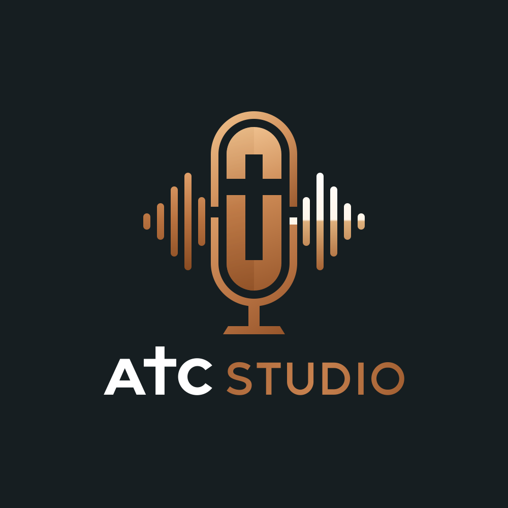

# ATC Studio

<p align="center"></p>

[](https://github.com/michaelrubi/atcStudio/actions/workflows/ci.yml)

As The Church Studio: drop in raw Sunday sermon or podcast audio and get a mastered,
denoised, bumper-stitched, speaker-labeled episode package.

The audio and ML engine is the `RestorationStation` library.

## Requirements

- Apple Silicon Mac (`arm64`)
- macOS 15 or newer
- Xcode 26 / Swift 6.2 or newer
- `ffmpeg`: `brew install ffmpeg` for local development
- For Title suggestions, Xcode's Metal Toolchain: `xcodebuild -downloadComponent MetalToolchain`

## Build and run

```bash
swift build
swift test
swift run ATCStudio
ATC_ML_TESTS=1 swift test --filter MLPipelineTests   # downloads ~0.9 GB of models once
```

You can also open `Package.swift` in Xcode and run the `ATCStudio` scheme.

## Layout

```
Package.swift
Sources/
  ATCStudio/                 SwiftUI app (window, tabs, views)
  RestorationStation/
    Audio/                   FFmpegRunner, MixPlan, AudioCompositionService, trim
    ML/                      Desert Ant models, MLPipelineActor, EpisodeAnalysis
    Export/                  EpisodePackage (VTT, episode info, show notes), EpisodePackageExporter
    Storage/                 GRDB models, migrations, DatabaseManager, assets
Tests/
  RestorationStationTests/   Database, mix-plan, and real-ffmpeg tests (Swift Testing)
assets/branding/             Logo, icon, and wordmark SVGs (placeholders)
scripts/                     setup_signing.sh (signing secrets), release scripts (Milestone 5)
```

## Credits

On-device AI by [Desert Ant Labs](https://desertant.com) 🐜 (Clear, Voz, Who, Align, Uhm, Title),
under the Desert Ant Labs Source-Available License 1.0.

## Release signing

Releases are signed with a Developer ID certificate and notarized in GitHub Actions.
To set up or renew the 7 signing secrets, run `./scripts/setup_signing.sh` and follow the steps.

## Data

- Database: `~/Library/Application Support/ATCStudio/atc_studio.sqlite`
- Exports: `~/Movies/ATC Studio Exports/YYYY-MM-DD_<Title>/` with `master_episode.mp3`,
  `transcript.vtt`, `episode_info.txt`, and `artwork.jpg`

## Status

- [x] Milestone 1: project, SQLite storage, Templates and Speakers tabs
- [x] Milestone 2: FFmpeg mixing and auto-ducking
- [x] Milestone 3: Desert Ant ML pipeline
- [x] Milestone 4: speaker mapping and export
- [ ] Milestone 5: release DMG
